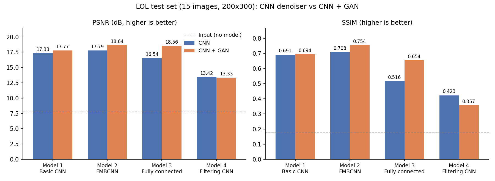

# Low-Light Image Denoising and Enhancement with CNNs and a GAN

Research question: How the integration of CNN-based denoising models and GAN-based techniques enhance the quality of low-light images?

This project trains four denoising networks on the LOL - low-light dataset. The proposed method suggests that the denoised CNN model’s ability to capture intricate features is refined through GAN training, resulting in enhanced visual quality in low-light conditions; that is, the denoised CNN model will be used as a generator in the GAN model to produce even more enhanced output.

## Models

| # | Model | Idea |
|---|---|---|
| 1 | Basic CNN | Encoder-decoder: two convolutions (64, 128), max-pooling, two transposed convolutions, up-sampling, sigmoid output |
| 2 | **FMBCNN** | Feature Map Based CNN: stride-2 convolutions (64, 128, 256) with up-sampling and skip connections that concatenate earlier feature maps |
| 3 | Fully connected | No convolutional layers: flatten, Dense 1024, Dense 512, Dense (pixels × 3, sigmoid), reshape. About 277M parameters at 200×300 |
| 4 | Filtering CNN | Convolution and batch-norm stages with pooling and up-sampling, then global average pooling and dense layers |

## Dataset

LOL dataset: paired low-light and normal-light images.
- Training pool: `our485` (485 pairs), split 80/20 into 388 training and 97 validation pairs (seed 42)
- Test: `eval15` (15 pairs), never used for model selection
- Images are resized to **200×300** to fit GPU memory

## Results

Scores on the 15 held-out test images. PSNR and SSIM are computed per image against the normal-light target and averaged (pixel range 0–1).

| Model | Stage | MSE ↓ | PSNR (dB) ↑ | SSIM ↑ |
|---|---|---|---|---|
| – | Input (no model) | 0.1940 | 7.77 | 0.180 |
| 1 Basic CNN | CNN | 0.0224 | 17.33 | 0.691 |
| | CNN + GAN | 0.0202 | 17.77 | 0.694 |
| 2 FMBCNN | CNN | 0.0200 | 17.79 | 0.708 |
| | CNN + GAN | **0.0180** | **18.64** | **0.754** |
| 3 Fully connected | CNN | 0.0267 | 16.54 | 0.516 |
| | CNN + GAN | 0.0241 | 18.56 | 0.654 |
| 4 Filtering CNN | CNN | 0.0498 | 13.42 | 0.423 |
| | CNN + GAN | 0.0504 | 13.33 | 0.357 |

### What the results show

- **Every model improves on the raw input** (7.77 dB), but much of that first gain is brightening. Model 4 reaches 13.4 dB with essentially a global brightness and colour correction, so the part above that is closer to real restoration.
- **FMBCNN (Model 2) gives the best result**, with the highest PSNR and SSIM after the GAN stage, and the best CNN-only scores too.
- **The GAN stage improved PSNR for Models 1–3** (+0.44, +0.85 and +2.02 dB). It improved SSIM clearly for Models 2 and 3, and barely for Model 1.
- **The GAN stage did not help Model 4.** Its architecture averages the whole image into 64 numbers before the output layer, so the output cannot follow image detail and there is nothing for the GAN to refine.
- **Model 3 plus GAN comes within 0.08 dB of FMBCNN plus GAN in PSNR**, a gap too small to separate on 15 images. FMBCNN keeps a clear lead in SSIM (0.754 against 0.654).
